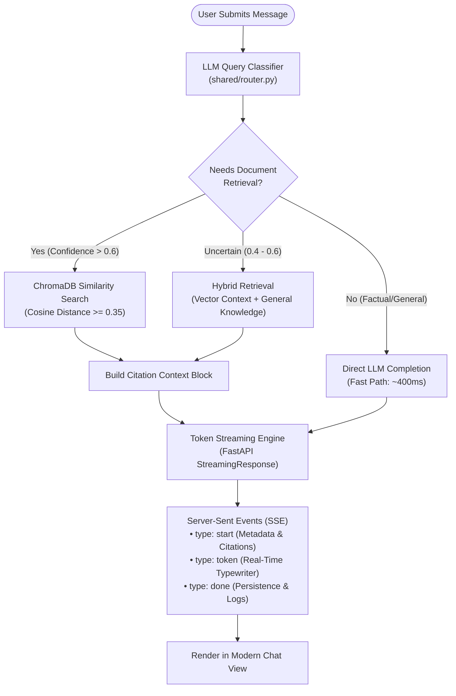
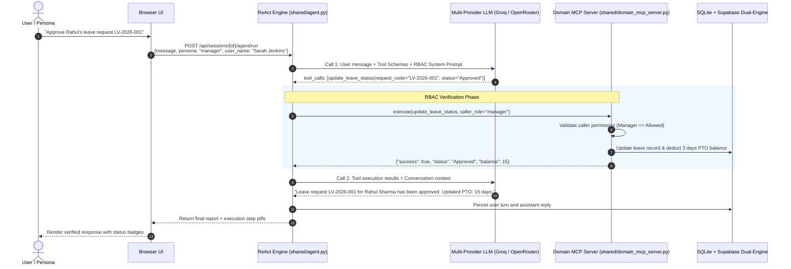

# AskRaggy · Enterprise Intelligence & Autonomous Agent Platform

<p align="center">
  
</p>

<p align="center">
  <strong>FastAPI-based enterprise AI assistant with RAG, MCP tool calling, streaming responses, multi-provider LLM support, and role-aware operations.</strong>
</p>

<p align="center">
  
  
  
  
  
  
  
  
  
</p>

---

## 🌟 Executive Summary: What is AskRaggy?

**AskRaggy** is an AI assistant service designed for **NeoIntelli HR & Operations**. It provides the following capabilities:

1. **Autonomous Tool-Calling Agents**: Solves operational tasks (employee directory queries, leave approvals, policy enforcement, expense filings) via **Model Context Protocol (MCP)** and local ReAct loops.
2. **SQLite and Optional Cloud Sync**: Uses local **SQLite (WAL Mode)** persistence with optional Supabase mirroring. Configure cloud sync explicitly for deployments where local disks are ephemeral.
3. **Real-Time Token Streaming**: Streams generated tokens directly to the browser via native **Server-Sent Events (SSE)** with a live typewriter effect and citation accordions — 100% free with zero third-party socket fees.
4. **Frictionless RBAC Demo Switcher**: Allows visitors to test both **Employee** and **Manager** roles with 1-click toggling, enforcing Role-Based Access Control in both LLM prompts and backend tools without sign-up barriers.
5. **Demo Protection**: Supports demo turn budgets, IP rate limiting, prompt guards, and optional **Bring-Your-Own-Key (BYOK)** configuration.
6. **Smart Content-Aware Export**: Heuristic export detection providing instant **CSV** buttons for generated tables, and clean PDF, Markdown, and clipboard copy without visual clutter.
7. **ChatGPT-Style Voice Interaction**: Powered by **ElevenLabs Scribe STT** with live pulsing soundwave visualizers, responsive mobile styling, and dark/light mode support.

---

## 🏛️ System Architecture

### 1. High-Level Topology

```
┌────────────────────────────────────────────────────────────────────────┐
│                   AskRaggy Modern Frontend (SPA)                       │
│  [💬 Smart Chat]   [📄 Docs Q&A]   [⚡ ReAct Agent]   [⚙️ BYOK & Tenant] │
│  [👤 Rahul (Emp) | 👔 Sarah (Mgr)]   [⚡ 15 Credits]   [📥 Export ▾]     │
└───────────────────────────────────┬────────────────────────────────────┘
                                    │ HTTP / SSE Stream
                                    ▼
┌────────────────────────────────────────────────────────────────────────┐
│                   FastAPI Application Gateway                          │
│   ├── Middleware: CORS, RequestID, Structured Logging, SlowAPI Limiter │
│   ├── Tenant Router: X-Tenant-ID Partitioning & Header Auth            │
│   └── API v1 Endpoints: /chat/smart/stream, /agent/run, /documents     │
└──────────────┬────────────────────┬────────────────────┬───────────────┘
               │                    │                    │
               ▼                    ▼                    ▼
     ┌──────────────────┐ ┌──────────────────┐ ┌──────────────────┐
     │  Smart Router    │ │   ReAct Agent    │ │  Ingestion &     │
     │  Classification  │ │  & MCP Server    │ │  Vector Memory   │
     │ (LLM/RAG/Hybrid) │ │ (5 HR Ops Tools) │ │ (ChromaDB + CAG) │
     └─────────┬────────┘ └────────┬─────────┘ └────────┬─────────┘
               │                   │                    │
               └─────────────┬─────┴────────────────────┘
                             │
                             ▼
 ┌───────────────────────────────────────────────────────────────────────┐
 │               Dual-Engine Storage & Persistence Architecture          │
 │                                                                       │
 │   ┌─────────────────────────────┐     ┌───────────────────────────┐   │
 │   │   Local SQLite (WAL Mode)   │────▶│ Supabase Cloud PostgreSQL │   │
 │   │  • Sub-millisecond reads    │sync │ • Survives container reboot │   │
 │   │  • Sessions, Messages, Tasks│     │ • Non-blocking HTTP mirror│   │
 │   └─────────────────────────────┘     └───────────────────────────┘   │
 └───────────────────────────────────────────────────────────────────────┘
```

---

### 2. Smart Router Query Lifecycle



---

### 3. ReAct Agent & Model Context Protocol (MCP) Execution Loop



---

## ⚡ Core Capabilities

This repository is suitable for local development and demos. Before production deployment, configure restricted CORS, durable shared persistence, authentication, monitoring, and backup/recovery procedures.

### 1. Real-Time Token Streaming (Native Server-Sent Events)
* **Zero External Fees**: Built natively using FastAPI `StreamingResponse(media_type="text/event-stream")` and browser `ReadableStream`.
* **Multi-Provider Support**: Streams live tokens from **Groq (Llama-3.3-70B)**, **OpenAI**, and **NVIDIA Nemotron** (handling both `reasoning_content` deltas and `content` deltas).
* **Live Typewriter Effect**: Displays a sleek blinking matcha cursor (`.streaming-cursor`), dynamic autoscrolling, Markdown formatting, and collapsible citation accordions.

### 2. Dual-Engine Persistence Architecture
* **The Cloud Ephemeral Challenge**: Free-tier cloud hosts (Render, Railway, Fly.io) wipe local filesystems on sleep or redeployment.
* **The Dual-Engine Solution**:
  * **Primary (Local)**: High-speed **SQLite in WAL mode** (`data/app_state.db`) with foreign key constraints ensures sub-millisecond local queries.
  * **Secondary (Cloud)**: Asynchronous non-blocking mirror to **Supabase Cloud PostgreSQL** (`sessions`, `messages`, `tasks`). If the container restarts, conversations remain intact.
  * **Graceful Degradation**: If Supabase is offline or unconfigured, the app falls back to local SQLite with zero latency penalty (<100ms timeout).

### 3. Role-Aware Demo Persona Switcher (RBAC)
Showcase enterprise permission boundaries with 1-click toggling — no login friction for LinkedIn visitors:

| Capability | 👤 Rahul Sharma (`EMP-101`)<br>*(Individual Contributor · Employee)* | 👔 Sarah Jenkins (`EMP-102`)<br>*(VP Engineering · HR Manager)* |
|:---|:---:|:---:|
| **Staff Directory Search** | ✅ Full Access | ✅ Full Access |
| **View HR Policies & PTO Balance** | ✅ Own Balance (18 Days) | ✅ Team Balances |
| **Submit Expense Claims** | ✅ Self-Filing (<$100 Auto-Approved) | ✅ Executive Claims |
| **Review Pending Leave Requests** | ❌ Blocked | ✅ Full Team Review |
| **Approve / Reject Leave Claims** | ❌ **Access Denied (RBAC)** | ✅ **Authorized Approver** |
| **Company-Wide Expense Audits** | ❌ Blocked | ✅ Full Audit Access |

> [!NOTE]
> **Defense-in-Depth RBAC**: Permissions are validated at **two independent layers**:
> 1. In the LLM System Prompt instructing the agent on role boundaries.
> 2. In the Python tool execution functions (`shared/domain_mcp_server.py`) which reject unauthorized role invocations.

### 4. Smart Name Disambiguation
Enterprise databases often have employees with identical first names. When a user asks:
> *"Submit a travel expense for Diya"* or *"Look up Diya"*

AskRaggy will **never guess or pick arbitrarily**. It queries the directory, identifies duplicates (**Diya Sharma** in Engineering vs. **Diya Patel** in Marketing), outputs a candidate comparison table, and requests the exact Employee Code before taking action.

### 5. Smart Content-Aware Export (Zero-Clutter UI)
* **Intelligent Heuristics**: Export controls only appear on AI bubbles that contain structured or rich data (tables, code snippets, cited retrieval sources, or detailed answers $\ge$ 150 words). Simple conversational replies remain clean and unbloated.
* **Contextual Quick Actions**: When a table is generated, an instant 📊 **CSV** export button surfaces directly on the bubble.
* **Full Multi-Format Export**:
  * **📄 Print / PDF**: Dedicated `@media print` layout that renders an executive summary without UI chrome.
  * **📊 Export Tables (CSV)**: Automatically extracts parsed tables into spreadsheet-ready `.csv` files.
  * **📝 Markdown Transcript (.md)**: Exports full conversation transcripts with metadata, personas, and citations.
  * **📋 Copy Text**: One-click clipboard copy of clean conversation prose.

### 6. ChatGPT-Style Live Voice Input (ElevenLabs STT)
* **One-Click Voice Dictation**: A sleek microphone button placed alongside the camera input in the chat toolbar.
* **ChatGPT-Inspired Recording Overlay**: Displays live audio visualizer soundwave bars, pulsating red indicator, and real-time elapsed timer (`00:03`).
* **High-Accuracy Speech-to-Text**: Transcribes spoken audio via **ElevenLabs Scribe STT** (`/v1/speech-to-text`) with automatic resilient fallback to Groq Whisper.
* **Universal Responsiveness**: Scales seamlessly across mobile, tablet, and desktop with dedicated Light Mode and Dark Mode styling.

### 7. LinkedIn Demo Token Protection & BYOK
* **Session Turn Budget**: Demo sessions are capped at **15 high-quality turns** to prevent bot draining.
* **Live Credit Indicator**: Top bar surfaces `⚡ 15 demo credits remaining`.
* **BYOK (Bring-Your-Own-Key)**: When credits reach 0, a modal invites the visitor to enter their own free Groq API key in Settings (⚙️) to unlock unlimited turns.
* **Rate Limiting**: `slowapi` enforces IP-level limits (30 req/min for chat, 15 req/min for agents).

---

## 🎯 Live Demo Guide: Try These Prompts!

Try these curated prompts to test every major architecture component:

### Test 1: Employee vs Manager Permissions (RBAC)
1. Select **👤 Rahul (Employee)** in the top bar.
2. Ask: `Approve Rahul's Diwali leave request LV-2026-001`
3. 👉 *Notice AskRaggy's polite RBAC refusal explaining that Employee roles cannot approve leaves.*
4. Switch to **👔 Sarah (Manager)** in the top bar.
5. Ask: `Approve Rahul's Diwali leave request LV-2026-001`
6. 👉 *Notice AskRaggy executes the tool, deducts days from balance, and confirms approval!*

### Test 2: Name Disambiguation & Database Search
1. Ask: `Add a $45 client lunch expense claim for Diya at Starbucks`
2. 👉 *Notice AskRaggy halts, displays both Diya Sharma and Diya Patel in a table, and asks for confirmation.*
3. Reply: `For EMP-106 Diya Sharma`
4. 👉 *Notice AskRaggy verifies under-$100 policy and auto-approves the claim!*

### Test 3: Real-Time Token Streaming
1. Ask: `What is our company policy on parental leave and health insurance reimbursement?`
2. 👉 *Watch the response stream token-by-token with real-time typewriter effect and collapsible citation badges.*

### Test 4: Autonomous ReAct Multi-Step Agent
1. Switch to the **⚡ Agent** tab.
2. Enter: `Find all staff members in Engineering, check who has pending leaves, and summarize team coverage for next week.`
3. 👉 *Observe the agent plan steps, invoke tools, inspect directory records, and synthesize an executive report.*

---

## 💻 Tech Stack

| Domain | Technology | Purpose |
|:---|:---|:---|
| **Backend Framework** | **FastAPI 0.115+** | High-performance async REST & SSE Streaming Gateway |
| **Language & Runtime** | **Python 3.12+** / **3.14** | Modern typing, asyncio, Pydantic v2 validation contracts |
| **Primary Storage** | **SQLite (WAL Mode)** | Zero-latency local caching for sessions, messages, and task logs |
| **Cloud Storage** | **Supabase PostgreSQL** | Cloud persistence mirror surviving container restarts |
| **Vector Engine** | **ChromaDB** | Vector similarity search with Cosine distance indexing |
| **Tool Protocol** | **Model Context Protocol (MCP)** | Decoupled client-server agent tool interoperability |
| **LLM Inference** | **Groq Llama-3.3-70B** | Sub-second inference latency for classification and synthesis |
| **Multi-Provider SDK** | **OpenAI, Anthropic, Cohere, Ollama** | Unified abstraction across commercial & open-source models |
| **Frontend UI** | **HTML5, Vanilla CSS3, Vanilla JS** | Lightweight, accessible, zero-dependency SPA with Dark/Light theme |
| **Testing & Quality** | **Pytest, pytest-asyncio, Ruff** | Unit/integration tests plus static linting |

---

## 🚀 Quickstart & Local Setup

### 1. Clone Repository & Install Dependencies

```bash
# Clone repository
git clone https://github.com/markasif/ai-engineering-learning.git
cd ai-engineering-learning

# Create and activate Python virtual environment
python -m venv .venv
source .venv/bin/activate  # On Windows: .venv\Scripts\activate

# Install package in editable mode with development dependencies
pip install -e ".[dev]"
```

### 2. Configure Environment Variables

Copy the template configuration file:
```bash
cp .env.example .env
```

Edit `.env` with your API keys (Groq is completely free):
```ini
# LLM Provider Configuration
DEFAULT_PROVIDER=groq
GROQ_API_KEY=gsk_your_groq_api_key_here
GROQ_MODEL=llama-3.3-70b-versatile

# Enterprise HR Domain Setting
ENTERPRISE_DOMAIN=NeoIntelli HR & Enterprise Operations
ENABLE_DOMAIN_MCP_SERVER=true

# Optional: Cloud Persistence Mirror (Free Tier)
SUPABASE_URL=https://your-project-id.supabase.co
SUPABASE_KEY=your_supabase_anon_or_service_key

# Security & Multi-Tenancy
ENABLE_MULTI_TENANT=true
TENANT_ID=demo
TRUST_TENANT_HEADER=false

# Optional ElevenLabs Speech-to-Text
VOICE_PROVIDER=elevenlabs
ELEVENLABS_API_KEY=your_elevenlabs_key
ELEVENLABS_STT_MODEL=scribe_v2
```

When `TRUST_TENANT_HEADER=false`, the server uses the configured `TENANT_ID`
and ignores client-supplied tenant headers. This keeps the public demo simple
while preventing visitors from selecting arbitrary tenants. Enable trusted
tenant headers only when an authenticated gateway injects them.

### 3. Launch Development Server

```bash
# Start FastAPI application with live hot-reloading
python -m uvicorn app.main:app --reload --host 0.0.0.0 --port 8000
```

* **Interactive Web Application**: Visit **[http://localhost:8000](http://localhost:8000)**
* **Interactive OpenAPI Swagger Docs**: Visit **[http://localhost:8000/docs](http://localhost:8000/docs)**
* **System Health Endpoint**: Visit **[http://localhost:8000/api/health](http://localhost:8000/api/health)**

---

## 🧪 Testing & Verification

The repository includes a comprehensive test suite covering unit logic, integration endpoints, and evaluation gates:

```bash
# Run the full test suite
pytest -v

# Run fast unit tests without network calls
pytest tests/unit/ -v

# Run integration smoke tests
pytest tests/integration/ -v

# Verify code formatting and linting
ruff check .
ruff format --check .
```

---

## 📂 Repository Layout

```
ai-engineering-learning/
├── app/                         # FastAPI Application Layer
│   ├── main.py                  # App factory, lifespan, CORS, middleware assembly
│   ├── core/                    # Config, rate limiting, logging
│   ├── schemas/                 # Pydantic v2 validation contracts (chat, agents, docs)
│   └── api/v1/endpoints/        # Chat, streaming, documents, agents, multimodal
│
├── shared/                      # Core AI Primitives & Multi-Provider Engine
│   ├── db.py                    # Centralized SQLite WAL database engine
│   ├── supabase_sync.py         # Non-blocking Supabase Cloud mirror
│   ├── agent.py                 # ReAct agent loop with RBAC enforcement
│   ├── domain_mcp_server.py     # 5 Live HR Operations MCP tools & mock database
│   ├── session_store.py         # Persistent session memory (SQLite + Cloud)
│   ├── vector_store.py          # ChromaDB vector embedding engine
│   ├── router.py                # Smart Query Intent Classifier
│   ├── planner.py               # Multi-step task planner
│   └── providers/               # Provider factory (Groq, OpenAI, Anthropic...)
│
├── ui/                          # Modern Frontend Single Page App (SPA)
│   ├── index.html               # Clean UI structure, Persona Switcher, Modals
│   ├── style.css                # Enterprise design system, Dark/Light, @media print
│   └── app.js                   # SSE stream consumer, RBAC state, export handlers
│
├── data/                        # Runtime data (ignored by Git)
│   └── app_state.db             # Local SQLite database when enabled
│
├── tests/                       # Unit, integration, and evaluation tests
│   ├── unit/                    # Deterministic unit tests (streaming, RBAC, quota)
│   └── integration/             # FastAPI TestClient endpoint & smoke tests
│
├── Dockerfile                   # Multi-stage production container
├── docker-compose.yml           # Stateful container setup with persistent volumes
└── pyproject.toml               # PEP 517/621 packaging & Ruff config
```

---

## 📄 License

This project is licensed under the **MIT License**.
