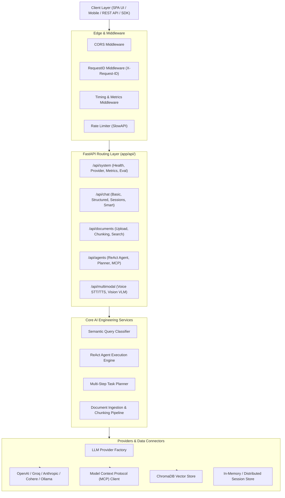
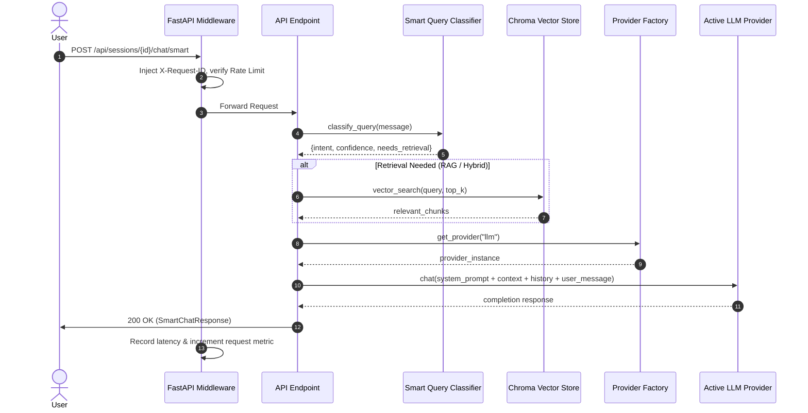

# System Architecture & Technical Specifications

This document outlines the architecture, layer contracts, data flow, and design patterns powering the AI Assistant microservice.

---

## 1. High-Level Layered Architecture

---

## 2. Directory and Package Layout

The project follows a standard Clean Architecture package structure:

* **`app/`**: Application-specific infrastructure, routes, schemas, and entrypoint.
  * **`main.py`**: App factory, lifespan hooks, middleware registration, static asset mounts.
  * **`core/`**: Centralized configuration (`config.py`), rate-limiting (`rate_limit.py`), logging setup.
  * **`schemas/`**: Pydantic v2 data transfer objects and validation contracts (`chat.py`, `documents.py`, `agents.py`, `multimodal.py`).
  * **`api/`**: Modular route definitions decoupled by feature domain (`chat.py`, `documents.py`, `agents.py`, `multimodal.py`, `system.py`).
* **`shared/`**: Reusable AI primitives and infrastructure adapters.
  * **`providers/`**: Multi-provider LLM abstraction layer implementing the Factory pattern for Groq, OpenAI, Anthropic, Cohere, Ollama, Azure, Bedrock, and Vertex.
  * **`agent.py`**: ReAct pattern agent execution engine.
  * **`planner.py`**: Multi-step autonomous task planner.
  * **`vector_store.py`**: Persistent ChromaDB vector embedding wrapper.
  * **`mcp_client.py`**: Model Context Protocol client for dynamically discovering and calling external tools.
  * **`ingestion.py`**: Multi-strategy text extraction (PDF, DOCX, TXT) and semantic chunking.
  * **`tenant_context.py`**: Multi-tenant isolation ensuring strict partition of sessions and document embeddings.
* **`tests/`**: Testing pyramid:
  * **`unit/`**: Deterministic unit tests with 0 API token cost.
  * **`integration/`**: FastAPI TestClient smoke and route validation tests.
  * **`eval/`**: Golden eval benchmark dataset and CI scoring script.
* **`ui/`**: Single Page Application (HTML, CSS, JS) mounted directly at the root `/`.

---

## 3. Request Lifecycle

---

## 4. Multi-Tenant Isolation Strategy

Multi-tenancy is enforced at the data layer:
1. Every request resolves a `tenant_id` via header (`X-Tenant-ID`), query parameter, or defaults to `"default"`.
2. Document records, document chunks, and chat sessions are keyed with `tenant_id`.
3. Vector similarity queries strictly apply metadata filtering: `where={"tenant_id": tenant_id}` so one tenant cannot retrieve or leak another tenant's vector embeddings.

